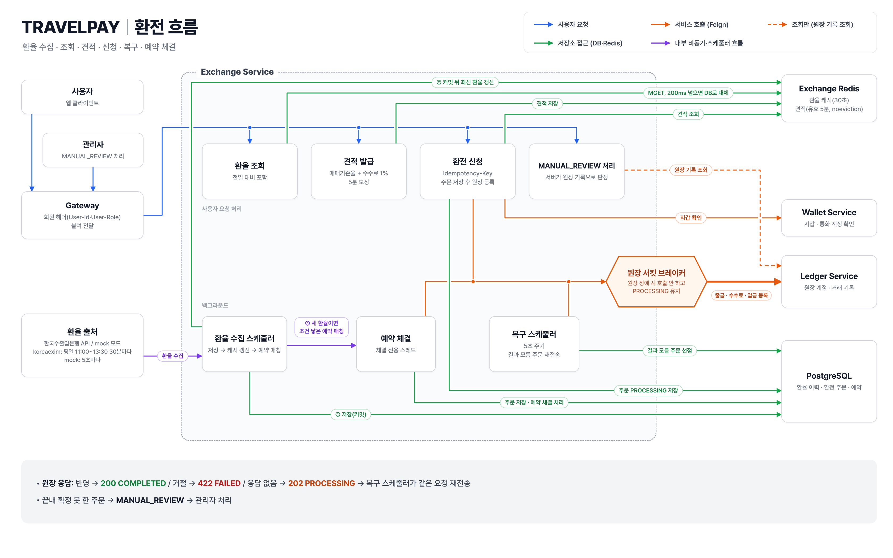

<div align="center">


# TravelPay — 환율·환전 개인 고도화

**여행자를 위한 충전·송금·환전·결제 통합 지갑 플랫폼 중 환율·환전 도메인 고도화**

</div>

> 팀 프로젝트 TravelPay를 기반으로 환율·환전 도메인을 개인 고도화한 저장소입니다.
> 원본 저장소: [dont-worrys/travelpay](https://github.com/dont-worrys/travelpay) · 팀 프로젝트 당시 이슈·PR 기록은 원본에서 확인할 수 있습니다.

<br/>

## 목차

1. [프로젝트 개요](#1-프로젝트-개요)
2. [팀 프로젝트에서의 역할](#2-팀-프로젝트에서의-역할)
3. [개인 고도화](#3-개인-고도화)
4. [시스템 아키텍처](#4-시스템-아키텍처)
5. [성능 테스트](#5-성능-테스트)
6. [팀원 및 역할](#6-팀원-및-역할)
7. [실행 방법](#7-실행-방법)

<br/>

## 1. 프로젝트 개요

TravelPay는 원화 충전, 회원 간 송금, 외화 환전, 가맹점 결제를 하나의 지갑에서 제공하는 MSA 기반 서비스입니다.

응답이 유실되거나 거래가 동시에 몰려도 잔액과 거래 상태가 어긋나지 않도록, 모든 자금 이동을 공용 원장에 한 번만 기록하고 결과를 모르는 거래는 다시 처리해 확정합니다. 끝내 확정하지 못한 거래는 대사와 운영자 보정으로 마무리합니다.

| 영역 | 범위 |
| --- | --- |
| 사용자·인증 | 회원가입·로그인, Redis 세션 인증, CSRF 보호·로그인 시도 제한 |
| 지갑·충전 | 지갑 개설·통화별 잔액 조회, 원화 충전·실패 시 환불 |
| 송금 | 사용자 간 통화별 지갑 송금 |
| **환율·환전** | **실시간 환율 조회, 견적 기반 환전, 목표 환율 도달 시 자동 체결되는 예약 환전** |
| 결제·정산 | 가맹점 결제·부분 환불·정산 |
| 원장 | 모든 자금 이동을 복식부기로 기록하는 공용 원장 |

### 기술 스택


<br/>

## 2. 팀 프로젝트에서의 역할

**환율·환전 담당** — 환율 수집·조회, 환전 견적·주문, 예약 환전, 원장 장애 격리

[환율·환전 가이드](docs/guide/exchange-service.md)

PR 번호는 모두 [원본 저장소](https://github.com/dont-worrys/travelpay/pulls?q=is%3Apr+exchange-service)의 PR입니다.

- **환율 수집·전일 대비:** 수집 출처를 한국수출입은행 API(`koreaexim`)와 가짜 환율(`mock`)로 나눠, 로컬·부하 측정은 외부 API 없이 동작. 한 통화 값만 이상하면 그 통화만 건너뜀. 전일 대비는 직전 고시일 값과 비교하고, 전일 값은 서버 메모리에 기억해 DB 읽기를 200ms까지만 기다림 ([#99](https://github.com/dont-worrys/travelpay/pull/99) · [#212](https://github.com/dont-worrys/travelpay/pull/212) · [#257](https://github.com/dont-worrys/travelpay/pull/257) · [#274](https://github.com/dont-worrys/travelpay/pull/274))
- **통화 금액 값 객체(Money):** 통화와 최소 단위 정수 금액을 묶은 불변 객체로 다뤄(CNY 10.50위안 = 1050), 통화 자릿수를 넘는 금액(JPY 100.5)은 만들 수 없고 다른 통화끼리는 계산되지 않음. 수수료 올림·환산 버림 같은 돈 계산 규칙은 도메인 객체(FeeRate·ExchangeRate)에 둠 ([#38](https://github.com/dont-worrys/travelpay/pull/38))
- **Redis 기반 환율·견적 처리:** 환율은 수집 커밋 뒤 Redis에 갱신해 한 번에(MGET) 조회하고, 200ms 안에 응답이 없으면 DB로 대체. 견적은 Redis에 저장(유효 5분, noeviction)하고 1회 사용은 주문 UNIQUE 제약으로 보장해, 요청마다 DB 연결을 쓰지 않음 ([#146](https://github.com/dont-worrys/travelpay/pull/146) · [#180](https://github.com/dont-worrys/travelpay/pull/180) · [#227](https://github.com/dont-worrys/travelpay/pull/227) · [#268](https://github.com/dont-worrys/travelpay/pull/268))
- **결과 모름 자동 확정·동시성 제어:** 원장에 출금·수수료·입금을 주문 ID로 한 번만 기록하고, 결과 모름은 202로 답한 뒤 복구 스케줄러가 같은 요청을 재전송해 확정. 같은 멱등 키 재요청은 원장을 부르지 않고 저장된 결과로 응답하며, 주문 상태는 WHERE status 원자적 UPDATE로 한 번만 반영 ([#73](https://github.com/dont-worrys/travelpay/pull/73) · [#77](https://github.com/dont-worrys/travelpay/pull/77) · [#80](https://github.com/dont-worrys/travelpay/pull/80) · [#81](https://github.com/dont-worrys/travelpay/pull/81) · [#218](https://github.com/dont-worrys/travelpay/pull/218))
- **서버 판정 기반 관리자 보정:** 끝내 확정하지 못한 주문은 MANUAL_REVIEW로 두고, 서버가 원장 기록을 조회해 결과를 판정 (관리자는 예상 결과를 확인하고 처리만 실행) ([#209](https://github.com/dont-worrys/travelpay/pull/209))
- **원장 장애 전파 차단·복구 속도:** 서킷 브레이커로 요청 스레드 고갈을 막고, 예약 체결을 환율 수집 스레드에서 분리해 장애가 환율 조회·견적으로 번지지 않게 함. 원장이 회복되면 복구 스케줄러가 쌓인 주문을 쉬지 않고 이어서 확정 ([#316](https://github.com/dont-worrys/travelpay/pull/316) · [#341](https://github.com/dont-worrys/travelpay/pull/341))
- **이벤트 기반 예약 자동 체결:** 새 환율이 저장될 때만 조건에 닿은 예약을 찾고, SKIP LOCKED로 잠근 뒤 조건을 다시 확인해 체결. 체결 주문은 멱등 키(reservation:{예약 ID})로 두 번 생성되지 않음 ([#247](https://github.com/dont-worrys/travelpay/pull/247) · [#255](https://github.com/dont-worrys/travelpay/pull/255))

<br/>

## 3. 개인 고도화

> 팀 프로젝트 종료(2026-11-22) 이후 진행 중입니다. 항목마다 문제 → 개선 → 결과 순서로 정리합니다.

<!--
### 3-1. (고도화 항목)

- **문제:**
- **개선:**
- **결과:**

(Before / After 다이어그램)
-->

<br/>

## 4. 시스템 아키텍처

> 현재 코드 기준입니다. 팀 프로젝트 당시 구조는 [원본 저장소](https://github.com/dont-worrys/travelpay#4-시스템-아키텍처)에서 볼 수 있습니다.

### 환전 흐름



신청 한 건의 처리 순서와 응답 코드는 [가이드의 처리 순서](docs/guide/exchange-service.md#처리-순서)에 있습니다.

### 인프라 설계도


### ERD


[ERD Cloud에서 보기](https://www.erdcloud.com/d/uqEkFQrcvkt94PT6A)

<br/>

## 5. 성능 테스트

> 운영 환경이 아닌 로컬 측정 결과이며, 개선 전후는 같은 날 같은 조건에서 비교했습니다. 측정 방법·조건·회차별 결과는 [부하 측정 README](exchange-service/load-test/README.md)에, 동작 설명은 [환율·환전 가이드](docs/guide/exchange-service.md)에 있습니다.

### 팀 프로젝트 당시

| 영역 | 문제 | 개선 | 결과 |
| --- | --- | --- | --- |
| 환율 조회 | 요청마다 DB 연결을 빌려 연결 10개 앞에서 대기 | 쿼리 통합 → Redis 캐시(MGET) ([#146](https://github.com/dont-worrys/travelpay/pull/146) · [#180](https://github.com/dont-worrys/travelpay/pull/180), 측정 [#206](https://github.com/dont-worrys/travelpay/pull/206)) | 동시 300 처리량 6,490 → 17,730건/초 (약 2.7배) |
| 견적 발급 | 요청마다 DB 연결을 빌려 연결 10개 앞에서 대기 | 견적 저장소 DB → Redis 전환 ([#227](https://github.com/dont-worrys/travelpay/pull/227), 측정 [#260](https://github.com/dont-worrys/travelpay/pull/260)) | 동시 300 처리량 3,051 → 14,525건/초 (약 4.8배), P95 226 → 33.9ms |
| 원장 장애 · 환전 신청 | 원장이 응답하지 않으면 신청이 요청 스레드 200개를 모두 붙잡아 환율 조회까지 멈춤 | 원장 호출 서킷 브레이커 ([#316](https://github.com/dont-worrys/travelpay/pull/316)) | 요청 스레드 200 → 평균 2.2개, 환율 조회 p50 8.1초 → 0.94ms, 응답 못 받음 약 28% → 0건 |
| 원장 장애 · 예약 체결 | 예약 체결이 환율 수집 스레드를 붙잡아 견적까지 503 (서킷만으로는 호출 수가 적어 열리지 않음) | 예약 체결을 전용 스레드로 분리 ([#316](https://github.com/dont-worrys/travelpay/pull/316)) | 2분간 환율 수집 0 → 24회, 견적 503 약 77% → 0건 |
| 원장 회복 뒤 복구 | 30초마다 50건 규칙 때문에 원장이 살아나도 쌓인 주문을 분당 약 100건만 확정 | 복구 스케줄러 연속 처리(제한 시간 20초)·5초 주기·회복 직후 재시도 대기 무시 ([#341](https://github.com/dont-worrys/travelpay/pull/341)) | 쌓인 주문 1,000건 확정 600 → 24초 (약 25배), 가장 느린 회차 890 → 34초 |

### 개인 고도화 이후

| 영역 | 문제 | 개선 | 결과 |
| --- | --- | --- | --- |
| - | - | - | - |

<br/>

## 6. 팀원 및 역할

| 이름 | 역할 | 담당 |
| --- | --- | --- |
| 박현아 | **팀장** · 지갑·충전·원장 | 프로젝트 일정 및 작업 조율, 지갑·충전, 결과 모름 처리·자동 복구, 충전 대사·보정, 공용 원장, MockBank |
| 김이찬 | 공통·인프라 | 공통 모듈·내부 통신, 회원·인증, API Gateway·요청 보안, AWS 인프라·CI/CD, 통합 모니터링 |
| 김지혜 | 프론트엔드·송금 | 프론트엔드 전체, 송금 API·상태 관리, 송금 멱등성·동시성, 송금 장애 대응 |
| **백가영** | **환율·환전** | **환율 수집·조회, 환전 견적·주문, 예약 환전, 원장 장애 격리** |
| 이안근 | 결제 | 가맹점 결제·환불·정산 |

팀원별 핵심 구현과 성능 개선은 [원본 README](https://github.com/dont-worrys/travelpay#6-핵심-기술-구현)에 있습니다.

<br/>

## 7. 실행 방법

> 배포 주소: https://travelpay.store (팀 프로젝트 배포)
> 환전은 원장·지갑·회원 서비스와 함께 동작하므로 전체 서비스를 띄워야 합니다.
> 자세한 로컬 설정은 [`docs/guide/local-settings.md`](docs/guide/local-settings.md)를 참고하세요.

### 준비물

| 도구 | 용도 |
| --- | --- |
| JDK 21 | 백엔드 실행 |
| Docker Compose | PostgreSQL·Redis·Kafka 실행 |
| Node.js 20.19 이상 | 프론트엔드 실행 ([travelpay-front](https://github.com/dont-worrys/travelpay-front)) |

### 1. 환경 파일

```bash
cp -n .env.example .env
```

- Wallet의 `WALLET_ACCOUNT_NUMBER_KEY`(Base64 32바이트)가 비어 있으면 기동하지 않으므로 `.env.example` 설명대로 채웁니다.
- 로컬에서는 `SPRING_PROFILES_ACTIVE=prod`를 켜지 않습니다.

### 2. 인프라

```bash
docker compose up -d postgres redis-session kafka redis-cache
```

### 3. 서비스

Eureka → User → Ledger → Mock Bank → Wallet → Payment·Exchange → Gateway 순서로 띄웁니다.

```bash
set -a; source .env; set +a
./gradlew :eureka-server:bootRun --args='--spring.config.name=application --spring.profiles.active=default'
# 다른 서비스도 모듈 이름만 바꿔 실행
# user-service, ledger-service, mock-bank, wallet-service, payment-service, exchange-service, gateway
```

| 서비스 | 필수 환경 변수 |
| --- | --- |
| Gateway | `GATEWAY_CORS_ALLOWED_ORIGINS=http://localhost:5173` |
| Wallet | `MOCK_BANK_URL=http://localhost:8090` |
| Exchange | `EXCHANGE_RATE_MODE=mock` |

기동 확인: Eureka `http://localhost:8761`에 서비스가 `UP`으로 보이면 됩니다.

### 4. 프론트엔드

```bash
git clone https://github.com/dont-worrys/travelpay-front.git
cd travelpay-front
npm install
cp .env.example .env.local
npm run dev   # http://localhost:5173
```
